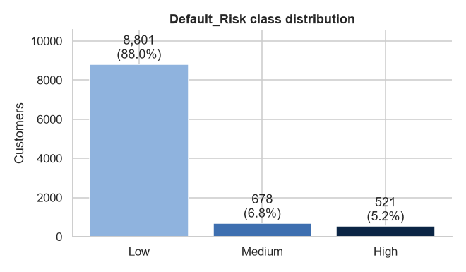
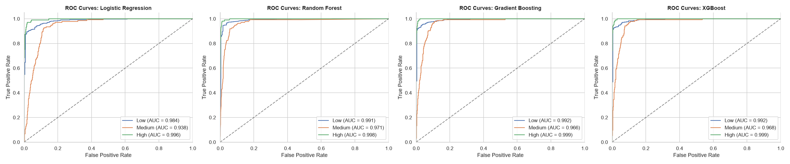
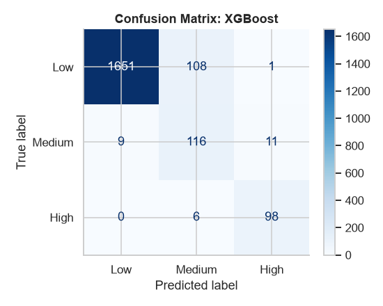

# Mkopo Insights: BNPL Default Risk Prediction

**Lipa Mdogo Mdogo (Buy Now, Pay Later) credit risk intelligence for Kenyan lenders**

[](https://mkopo-insights.streamlit.app/)


**Live demo:** <https://mkopo-insights.streamlit.app/>

> Data Science Capstone Project, Moringa School (DSF-PT15, Group 3)

---

## Table of Contents

1. [Overview](#-overview)
2. [Business Problem](#-business-problem)
3. [Dataset](#-dataset)
4. [Methodology](#-methodology)
5. [Results](#-results)
6. [The Dashboard](#-the-dashboard)
7. [Repository Structure](#-repository-structure)
8. [Getting Started](#-getting-started)
9. [Team](#-team)
10. [License](#-license)

---

## Overview

Buy Now, Pay Later (known locally as *Lipa Mdogo Mdogo*) lets customers take goods immediately and repay in instalments. It grows merchant sales and provider revenue, but late or missed repayments expose providers to credit risk, collection costs and portfolio deterioration.

**Mkopo Insights** is an end-to-end data science project that:

- Analyses customer behaviour and BNPL exposure in a 10,000-customer dataset
- Trains and compares four machine-learning classifiers to predict a customer's **default risk category** (`Low`, `Medium`, `High`)
- Deploys the best model in an interactive **Streamlit decision-support dashboard** with risk scoring, portfolio analytics and credit-management tools

All monetary values are presented in **Kenya shillings (KSh)**.

---

## Business Problem

BNPL providers need a reliable way to assess credit risk **before** extending credit and to monitor it **during** repayment. Without it, providers either absorb avoidable losses or restrict credit to customers who could have repaid.

**Project objectives**

| # | Objective |
|---|-----------|
| 1 | Identify the customer characteristics most associated with default risk |
| 2 | Build and compare predictive models that classify customers into Low / Medium / High risk |
| 3 | Handle class imbalance so the minority (risky) classes are detected, not ignored |
| 4 | Turn the model into a usable tool that supports credit-limit and monitoring decisions |

---

## Dataset

- **Source:** Kaggle, [*Buy Now Pay Later (BNPL) Default Risk*](https://www.kaggle.com/datasets/itzzomkar/buy-now-pay-later-bnpl-default-risk) (CC0)
- **Size:** 10,000 customers × 11 columns
- **Target:** `Default_Risk` (`Low`, `Medium`, `High`)

| Column | Type | Description |
|--------|------|-------------|
| `Customer_ID` | Identifier | Unique customer key (excluded from modelling) |
| `Age` | Numeric | Age in years |
| `Employment_Status` | Categorical | Employed, Student, Freelancer, Unemployed |
| `Income_USD` | Numeric | Annual income in USD → converted to `Monthly_Income_KES` |
| `Credit_Score` | Numeric | Credit score |
| `Total_BNPL_Active_Loans` | Numeric | Number of active BNPL loans |
| `Total_BNPL_Debt_USD` | Numeric | Outstanding BNPL debt → converted to `Total_BNPL_Debt_KES` |
| `Late_Payment_History` | Binary | Whether the customer has paid late before |
| `Shopping_Category_Most_Frequent` | Categorical | Fashion, Electronics, Home/Furniture, Travel, Groceries/Essentials |
| `Average_Transaction_Value_USD` | Numeric | Average purchase value → converted to `Average_Transaction_Value_KES` |
| `Default_Risk` | Target | Low / Medium / High |

**Key data facts**

- No duplicate rows or duplicate customer IDs
- Missing values only in `Credit_Score` (298, 2.98%) and `Income` (305, 3.05%); the missingness was **not** significantly associated with risk (chi-square p > 0.05)
- **Highly imbalanced target:** 88.0% Low, 6.8% Medium, 5.2% High (≈ 17:1 majority-to-minority ratio)
- **Localisation:** USD values converted to KES at a fixed rate of **1 USD = KSh 129.89** (income also divided by 12 to give monthly income in the notebook)



---

## Methodology

The project follows the **CRISP-DM** framework (Business Understanding → Data Understanding → Data Preparation → Modelling → Evaluation → Deployment). The full workflow lives in [`Lipa_Mdogo_Mdogo_BNPL (1).ipynb`](<Lipa_Mdogo_Mdogo_BNPL (1).ipynb>). Metrics for the deployed model are stored in [`Mkopo_Insights/reports/`](Mkopo_Insights/reports).

### 1. Exploratory Data Analysis
- Distribution, skewness and outlier checks (IQR) for all numeric features
- Risk profile by employment, late-payment history and shopping category
- ANOVA (numeric) and chi-square (categorical) tests against the target; Spearman correlations

**What the EDA found:** higher-risk customers tend to have **lower income, lower credit scores, more active loans and higher BNPL debt**. Employment status, income, late-payment history, credit score, debt and active loans were all significantly associated with risk (p < 0.05). Age, transaction value and shopping category were not.

### 2. Data Preparation
- **Stratified 80/20 train/test split** (8,000 / 2,000) performed *before* imputation to avoid data leakage
- **Median imputation by employment group**, using training-set medians only. All 603 imputations are logged in [`reports/data_cleaning_log.csv`](reports/data_cleaning_log.csv)
- `ColumnTransformer` pipeline: standard scaling for numeric features and one-hot encoding for categoricals

### 3. Modelling
Four classifiers were tuned with **stratified 5-fold cross-validation** and `GridSearchCV`, optimising **macro F1** so that minority classes carry equal weight. Preprocessing and model are combined in a single scikit-learn `Pipeline`, and class imbalance is handled with class/sample weights.

- Logistic Regression (baseline)
- Random Forest
- Gradient Boosting
- XGBoost (deployed)

The notebook also includes an optional, exploratory BERT fine-tuning experiment on text-serialised customer profiles. It is documented as a benchmark only and is **not** used in the deployed app.

### 4. Evaluation
Accuracy, macro precision, macro recall and macro F1 on the held-out test set, plus per-class classification reports, confusion matrices, one-vs-rest ROC curves and tree-based feature importances. The model with the best cross-validated macro F1 is saved as the recommended model.

---

## Results

### Model comparison

Results from the deployed evaluation reports (`Mkopo_Insights/reports/`):

| Model | CV Macro F1 | Test Accuracy | Test Macro Precision | Test Macro Recall | Test Macro F1 |
|-------|:-----------:|:-------------:|:--------------------:|:-----------------:|:-------------:|
| **XGBoost** | **0.867** | 94.85% | 80.80% | 87.49% | 83.75% |
| Random Forest | 0.862 | **95.20%** | **82.63%** | 87.70% | **84.84%** |
| Gradient Boosting | 0.843 | 93.40% | 78.99% | **89.58%** | 82.97% |
| Logistic Regression | 0.785 | 87.85% | 71.02% | 83.18% | 74.02% |

**XGBoost** has the highest cross-validated macro F1 and is the model deployed in the dashboard (`Mkopo_Insights/models/recommended_lipa_mdogo_mdogo_model.joblib`). Random Forest is marginally ahead on the held-out test set (about 1 point of macro F1), and both clearly outperform the linear baseline.

**Deployed pipeline:** median imputation + standard scaling for 6 numeric features, most-frequent imputation + one-hot encoding for 3 categorical features (17 model inputs), followed by `XGBClassifier` with `n_estimators=180`, `max_depth=5`, `learning_rate=0.1`.

### What drives the predictions?

Permutation importance of the deployed model (drop in macro F1 when a feature is shuffled):

| Rank | Feature | Importance |
|:----:|---------|:----------:|
| 1 | Monthly income (KES) | 0.327 |
| 2 | Total BNPL debt (KES) | 0.323 |
| 3 | Late payment history | 0.105 |
| 4 | Employment status | 0.037 |
| 5 | Credit score | 0.015 |
| 6 | Active BNPL loans | 0.014 |

Age, shopping category and average transaction value contribute little or nothing.

<p align="center">
  
  
</p>

---

## Dashboard

The Streamlit app ([`Mkopo_Insights/app.py`](Mkopo_Insights/app.py)) is organised into five pages:

| Page | What it does |
|------|--------------|
| **Executive Overview** | Portfolio KPIs (customers, total/average BNPL debt, high-risk share), risk composition, risk by employment and shopping category, data-quality snapshot |
| **Customer Risk Assessment** | Score an existing customer by ID, or enter a new customer's details. Returns the predicted risk class, class probabilities and a recommended management action |
| **Credit Management** | Configurable risk-concentration alerts, observed default-rate monitoring, a credit-limit adjustment simulator and a customer segment explorer |
| **Portfolio Analytics** | Filter by risk, employment and late-payment history; view debt exposure charts and download the filtered portfolio as CSV |
| **Model Performance** | Test and CV metrics, model comparison, confusion matrices, permutation importance and downloadable evaluation reports |

**Risk-based recommendations**

| Predicted risk | Suggested action |
|----------------|------------------|
| High | Enhanced due diligence; verify income; consider limit reduction; escalate for manual review |
| Medium | Controlled credit monitoring; avoid automatic limit increases |
| Low | Standard monitoring; consider gradual limit increases where repayment capacity supports it |

**Model inputs required for a new customer:** age, monthly income (KSh), credit score, active BNPL loans, total BNPL debt (KSh), average transaction value (KSh), employment status, late-payment history and most frequent shopping category.

---

## Repository Structure

```
.
├── Lipa_Mdogo_Mdogo_BNPL (1).ipynb      # Latest notebook: EDA, preparation, modelling, evaluation, BERT experiment
├── Lipa_Mdogo_Mdogo_BNPL.ipynb          # Earlier version of the notebook (superseded)
├── BNPL_Financial_Default_Risk_Dataset.csv
├── figures/                             # EDA, ROC, confusion-matrix and importance plots
├── models/                              # All trained models (.joblib)
├── reports/
│   └── data_cleaning_log.csv            # Log of every imputed value
├── Research Proposal *.docx             # Project proposals and plan
│
├── Mkopo_Insights/                      # Deployment package (Streamlit Cloud)
│   ├── app.py                           # Streamlit dashboard
│   ├── requirements.txt
│   ├── data/BNPL_Financial_Default_Risk_Dataset.csv
│   ├── models/recommended_lipa_mdogo_mdogo_model.joblib   # Deployed XGBoost pipeline
│   ├── reports/                         # CV results, test results, permutation importance
│   └── figures/                         # Confusion matrices and EDA figures used by the app
│
├── LICENSE
└── README.md
```

---

## Getting Started

### Prerequisites
- Python 3.10+
- `pip`

### Run the dashboard locally

```bash
# 1. Clone the repository
git clone https://github.com/<your-username>/dsf-pt15m6-capstone-project-group3.git
cd dsf-pt15m6-capstone-project-group3

# 2. Create a virtual environment or use conda environment kernel.
# 3. Launch the app (run from inside Mkopo_Insights)
cd Mkopo_Insights
streamlit run app.py
```

The app opens at `http://localhost:8501`.


### Tech stack

`Python` · `pandas` · `NumPy` · `SciPy` · `scikit-learn` · `XGBoost` · `Matplotlib` · `Seaborn` · `Plotly` · `Streamlit` · `joblib`

---


**Known areas for improvement**

- Validate on real Kenyan lender data with observed repayment outcomes
- Adjust the income to reflect Kenyan Job paygrade
- Align the income transformation between the notebook (annual USD ÷ 12 → monthly KES) and the app's data loader so scoring inputs are on the same scale the model was trained on
- Add fairness auditing, probability calibration and external validation
- Add automated tests and CI

---

## Team

**Capstone Group 3, Moringa School Data Science (DSF-PT15)**

- Francis Kamau
- Kelvin Namutenda Omuncheyi
- Benedict Onyango Aloo
- George Okumu
- Faith Ngina Muiruri
- Barbara Kinoti

---

## License

Released under the [MIT License](LICENSE). The underlying dataset is published on Kaggle under CC0.
